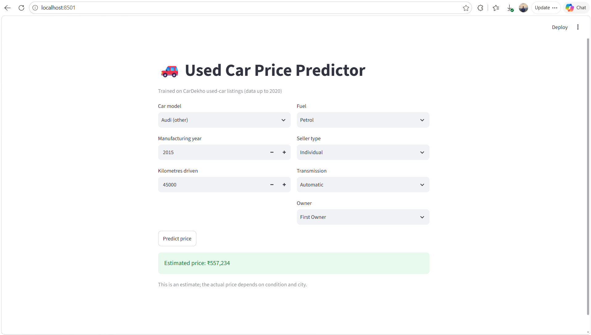

# Used Car Price Predictor

A machine learning web app that estimates the resale price of a used car in India from its model, age, kilometres driven, fuel type, transmission, seller type and ownership history.



## Highlights
- Trained on **4,340 CarDekho used-car listings**, cleaned down to unique, plausible records
- Final **Random Forest** model: **5-fold CV R² of 0.83** on log price, with a median error of about **19%**
- Improved CV R² from **0.735 to 0.826** by replacing brand with car model as the key feature
- Interactive **Streamlit** app for instant estimates

## Tech Stack
Python, Pandas, NumPy, Scikit-learn, Matplotlib, Seaborn, Streamlit, Joblib

## Dataset
CarDekho used-car listings from Kaggle. Each row has the car name, manufacturing year, selling price (INR), kilometres driven, fuel type, seller type, transmission and owner type. Listings run up to 2020, so the app uses 2020 as the reference year when computing car age.

## Approach
1. **Cleaning:** removed 763 duplicate listings and implausible mileage values (under 500 km or over 300,000 km).
2. **EDA:** price is heavily right-skewed. Price falls with age, and diesel, automatic and luxury cars sell higher.
3. **Feature engineering:** derived `car_age` and extracted the car model (for example "Maruti Swift") from the raw listing name. Rare models fall back to their brand (for example "Audi (other)").
4. **Target transform:** trained on `log(1 + price)` so expensive cars do not dominate the loss, then converted predictions back to rupees.
5. **Modelling:** compared Linear Regression, Random Forest and Gradient Boosting, then tuned a Random Forest (100 trees, max depth 20).
6. **App:** a Streamlit interface loads the saved model and returns an estimate.

## Results

| Version | 5-fold CV R² (log price) |
|---|---|
| Baseline, brand as feature | 0.735 |
| Car model as feature | 0.798 |
| Final model | 0.826 |

Final model on a held-out 20% test set:

| Metric | Value |
|---|---|
| R² (log price) | 0.812 |
| R² (price in rupees) | 0.678 |
| Mean absolute error | ₹1.19 lakh |
| Median error | about 19% |

R² on rupees is lower than on log price because a few expensive cars produce large absolute errors.

## Example Predictions

| Car | Inputs | Estimate |
|---|---|---|
| Maruti Swift | 2015, 50,000 km, Petrol, Individual, Manual | ₹3.3 lakh |
| Toyota Innova | 2012, 100,000 km, Diesel, Individual, Manual | ₹5.6 lakh |
| Audi (other) | 2016, 40,000 km, Diesel, Dealer, Automatic | ₹21.1 lakh |

## Limitations
- Luxury brands (Audi, BMW, Mercedes) have few listings, and all of them are automatic, so their estimates are rough.
- The data has no engine size, power, trim, condition or city, so estimates are indicative only.
- Listings end in 2020, so the model does not reflect current market prices.

## Future Improvements
- Add engine, power and mileage features from a richer dataset
- Try gradient boosting libraries such as XGBoost or LightGBM
- Add prediction intervals instead of a single point estimate
- Deploy the app on Streamlit Community Cloud

## Run Locally
```bash
git clone https://github.com/rishabhbhardwaj086/Used-Car-Price-Predictor.git
cd Used-Car-Price-Predictor
pip install -r requirements.txt
streamlit run app.py
```

## Project Structure
```
├── UCP.ipynb                       # cleaning, EDA, model comparison, training
├── app.py                          # Streamlit app
├── model.pkl                       # trained Random Forest
├── columns.pkl                     # feature columns expected by the model
├── models_list.pkl                 # car models shown in the app dropdown
├── CAR DETAILS FROM CAR DEKHO.csv  # dataset
├── requirements.txt
└── Screenshot.png
```

## Author
**Rishabh Bhardwaj**, B.Tech Computer Science (AI/ML), DIT University, Dehradun
